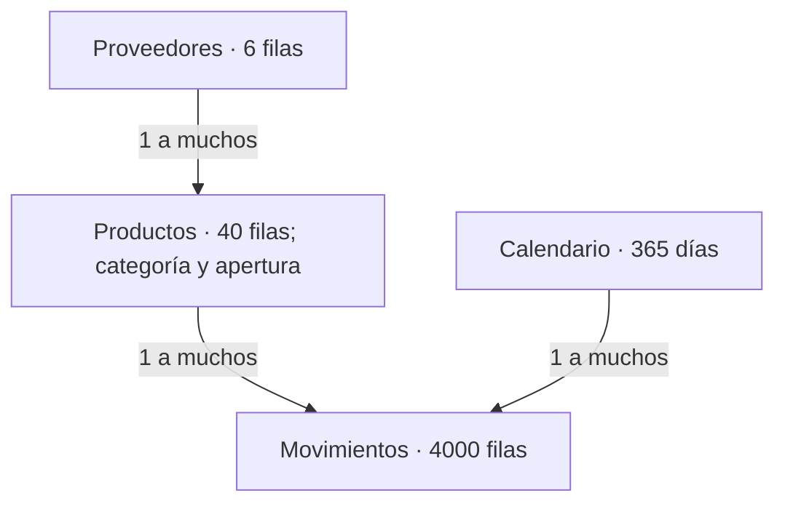

# Modelo y reglas

## Relacional PostgreSQL
`categorias 1 → * productos`, `proveedores 1 → * productos`, `productos 1 → * movimientos`, `calendario 1 → * movimientos`. Claves enteras salvo la fecha. La categoría y el proveedor se almacenan una sola vez por producto. El costo repetido del movimiento se conserva para trazabilidad y se restringe a ser igual al costo maestro en este alcance de costo constante. El stock inicial está en Productos; no es un movimiento de 2025.

## Dimensional Power BI
Esquema de estrella con una pequeña extensión en copo de nieve para proveedores. Se evita una segunda relación Proveedores–Movimientos: produciría dos caminos de filtro y podría separar el saldo inicial del saldo de movimientos. Categoría es atributo desnormalizado de Productos; la consulta Categorias sirve de preparación y no se carga al modelo.

| Lado 1 | Lado muchos | Cardinalidad | Filtro activo |
|---|---|---|---|
| Proveedores[proveedor_id] | Productos[proveedor_id] | 1:* | Solo Proveedores → Productos |
| Productos[producto_id] | Movimientos[producto_id] | 1:* | Solo Productos → Movimientos |
| Calendario[fecha] | Movimientos[fecha] | 1:* | Solo Calendario → Movimientos |

No hay relaciones bidireccionales ni muchos-a-muchos. Un proveedor filtra Productos y por esa vía sus movimientos y apertura. Calendario filtra los flujos sin quitar productos sin movimientos del catálogo. No hay tabla adicional de apertura: una fila por producto permite conservar el modelo pequeño.

También se entrega `modelo.svg`. Grano del hecho: un movimiento de un producto en una fecha. Orden del libro de inventario: fecha, movimiento_id; el ID desempata operaciones del mismo día. Los saldos diarios usan cierre del día.

## Diccionario
| Tabla | Campo | Tipo / significado |
|---|---|---|
| categorias | categoria_id; categoria | Entero PK; texto único |
| proveedores | proveedor_id; proveedor; ciudad | Entero PK; nombre ficticio; ciudad |
| productos | producto_id; codigo; producto | Entero PK; código único PRD-nnn; nombre y presentación |
| productos | categoria_id; proveedor_id | FK a sus dimensiones |
| productos | costo_unitario; precio_referencia | Decimal 12,2 PEN por unidad; costo fijo y precio orientativo |
| productos | stock_minimo; stock_inicial | Enteros; umbral positivo y apertura no negativa anterior al 01/01/2025 |
| productos | activo | Booleano; todos los 40 activos en el conjunto entregado |
| movimientos | movimiento_id; fecha; producto_id | PK; FK Calendario; FK Productos |
| movimientos | tipo; cantidad; costo_unitario | entrada/salida; entero positivo; decimal PEN positivo |
| calendario | fecha; anio; mes | PK diaria; año 2025; mes 1–12 |
| calendario | anio_mes; mes_nombre | YYYY-MM ordenable; abreviatura española, ordenar por mes |
| Productos (BI) | categoria | Texto obtenido mediante unión con Categorias |
| Movimientos (BI) | cantidad_neta; importe | Entero firmado; cantidad × costo, ambos calculados en M |

## Reglas de indicadores
- **Flujos**: Total entradas, Total salidas, Importe entradas y Costo salidas respetan todas las fechas visibles. Entradas/salidas se muestran juntas por Calendario[anio_mes]. El signo solo se usa para obtener el saldo; ambos flujos se presentan positivos.
- **Stock actual**: apertura + entradas acumuladas − salidas acumuladas desde el inicio hasta MAX(fecha visible). Un filtro marzo–abril calcula flujos de ambos meses, pero el stock incluye enero–abril. Sin filtro, el corte es 31/12/2025. El total de una tabla mensual recalcula saldo al último corte; no suma saldos de los meses.
- **Valor inventario**: suma por producto de saldo × costo unitario. No multiplicar stock total por costo promedio simple. El costo aplicable no varía en estos datos; no es una solución de valoración para costos variables.
- **Productos activos**: filas activas en la selección de producto/categoría/proveedor, incluso sin movimientos en el periodo. La fecha no determina actividad. No hay fechas de alta/baja.
- **Stock bajo**: activo y saldo estrictamente menor que mínimo. Igual al mínimo no es bajo. Porcentaje = bajo / activos.
- **Rotación**: costo de salidas del periodo / promedio diario de inventario valorizado al cierre. Incluye días sin movimientos; no anualiza. Cero denominador produce BLANK. No sumar rotaciones mensuales. Con fechas discontinuas promedia únicamente días seleccionados, y los saldos en esos días incluyen la historia intermedia.
- **Reposición**: máximo(mínimo − saldo, 0), sumado solo para activos; alcanza el mínimo, no un stock objetivo comercial.
- **Salidas por categoría**: la misma medida de salidas con Productos[categoria] en el eje.
- **Por proveedor**: solo proveedor principal del producto; las entradas se interpretan como recepciones de ese proveedor. Las salidas atribuidas al proveedor son despachos de su catálogo.

Los filtros admitidos para interpretar los KPI son dimensiones (producto, categoría, proveedor y fecha). No filtrar KPI de saldo con ID de movimiento, cantidad o fecha tomada de la tabla de hechos. Desactivar la interacción de la tabla de movimientos con los KPI de saldo; seleccionar una fila no equivale a seleccionar un periodo de inventario.

Las medidas completas, con descripción y formato, están en `powerbi/medidas.json`; sus fórmulas pegables están en `powerbi/medidas.dax`. La validación pandas/SQL usa exactamente las reglas de periodo, costo y cierre aquí descritas.
